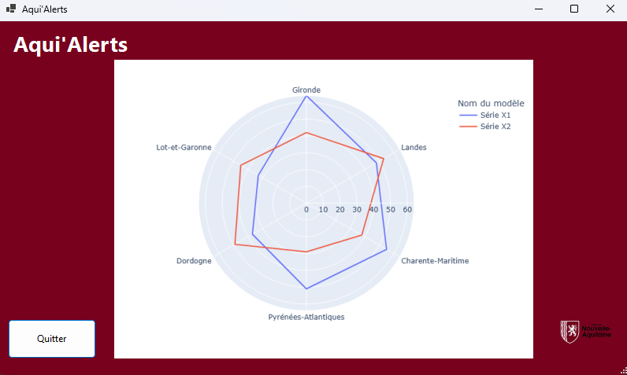
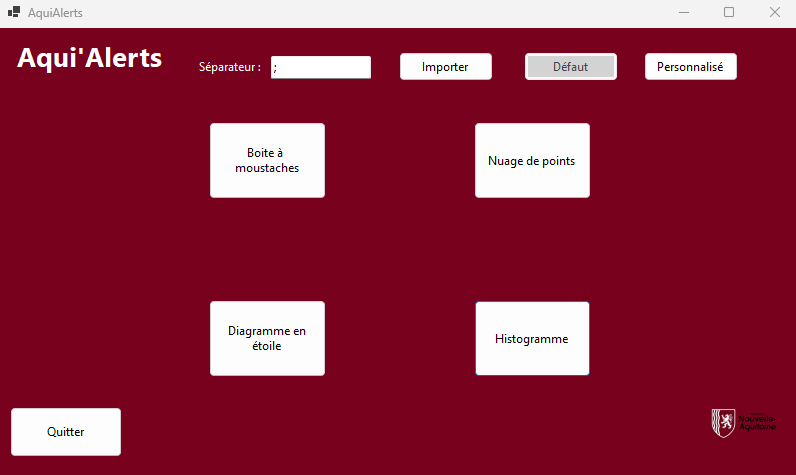
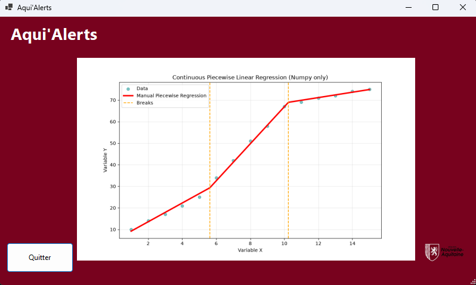
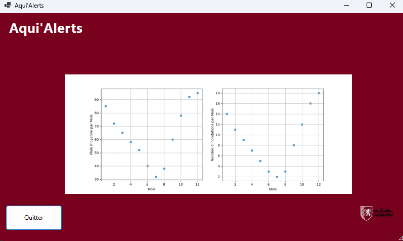
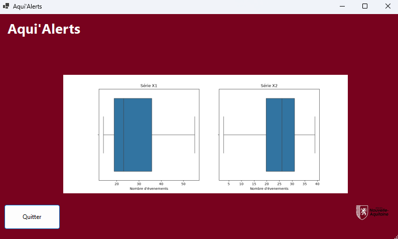

# Aqui'Alerts — Analyse des Risques Climatiques & Tableau de Bord

[English Version](README.md)


*Tableau de bord WinForms C# affichant un graphique radar polaire Plotly comparant les distributions d'événements climatiques multi-départementaux (`Gironde`, `Landes`, `Charente-Maritime`, etc.).*

Aqui'Alerts est une plateforme complète d'analyse des risques climatiques et environnementaux combinant **une application de bureau C# .NET Windows Forms** pour le pilotage et les requêtes, et **un moteur d'analyse de données Python** (utilisant Matplotlib, Seaborn, Plotly et Pandas) pour générer des graphiques statistiques dynamiques et des cartes choroplètes.

---

## Interface & Utilisation


*Tableau de bord par défaut de l'application de bureau C#, contrôles d'importation CSV avec délimiteur personnalisé et sélecteur de mode (`Défaut` / `Personnalisé`).*

L'application fournit une interface de bureau intuitive permettant aux opérateurs de charger des jeux de données CSV régionaux, d'exécuter des requêtes SQL personnalisées sur la base de données sous-jacente et de rendre instantanément des graphiques statistiques multivariables.

---

## Analyses & Algorithmes


*Algorithme personnalisé de régression linéaire par morceaux (piecewise) implémenté en pur NumPy avec des points de rupture basés sur des quantiles.*

### Modules Statistiques Avancés
- **Régression Linéaire par Morceaux** : Modélise les tendances écologiques et climatiques non linéaires complexes en ajustant des régressions linéaires segmentées à travers les quantiles de données.
- **Galerie Statistique Comparative** :

| Nuage de Points (Corrélation) | Boîte à Moustaches Statistique |
| :---: | :---: |
|  |  |
| *Visualisations statistiques comparatives à double série (`Série X1` vs `Série X2`) générées via le pipeline C#-Python.* | *Analyse de distribution à travers plusieurs indicateurs de risques environnementaux.* |

---

## Architecture

```text
climate-risk-analytics/
├── Aqui'Alerts C#/          # Application de bureau C# .NET Windows Forms
├── Aqui'Alerts SQL/         # Modèles de base de données (MCD, scripts MLR, dumps SQL)
└── pythonScripts/           # Scripts Python de traitement de données et génération de graphiques
    ├── choosenGraph.py      # Point d'entrée principal (aiguilleur)
    ├── boxplot.py           # Boîtes à moustaches statistiques
    ├── radarChart.py        # Graphiques radar multi-axes
    ├── scatterPlot.py       # Nuages de points de corrélation
    ├── linearRegression.py  # Analyse de tendances & régression linéaire
    ├── histogram.py         # Histogrammes de distribution de fréquences
    ├── parallelCoordinates.py# Coordonnées parallèles multivariées
    ├── geographicPlot.py    # Cartes de risques choroplètes
    └── requirements.txt     # Dépendances Python
```

## Prérequis (Windows)

Pour exécuter la pile applicative complète sur Windows :
- **Windows 10 / 11**
- **.NET 8.0 SDK** (pour l'application Windows Forms C#)
- **Python 3.10+** (avec pip)
- **Base de données SQL** (MSSQL / MySQL / compatible)

## Comment Lancer sur Windows

### 1. Configuration de la Base de Données
Importez le schéma de base de données et les données initiales depuis le dossier `Aqui'Alerts SQL/` vers votre instance de serveur SQL.

### 2. Configuration de l'Environnement Python
Ouvrez l'Invite de commandes ou PowerShell dans le dossier `pythonScripts/` et installez les dépendances :
```cmd
cd pythonScripts
pip install -r requirements.txt
```

### 3. Lancement de l'Application de Bureau C#
1. Ouvrez la solution C# dans Visual Studio (`Aqui'Alerts C#/Aqui'Alerts/Aqui'Alerts.sln`).
2. Configurez votre chaîne de connexion à la base de données dans les paramètres du projet.
3. Appuyez sur `F5` pour compiler et exécuter l'application. L'interface C# appellera automatiquement les scripts Python lors de la génération des graphiques analytiques.

---
**Documentation & Détails :** Consultez les sous-dossiers respectifs pour les schémas SQL et les fonctions détaillées des modules Python.
