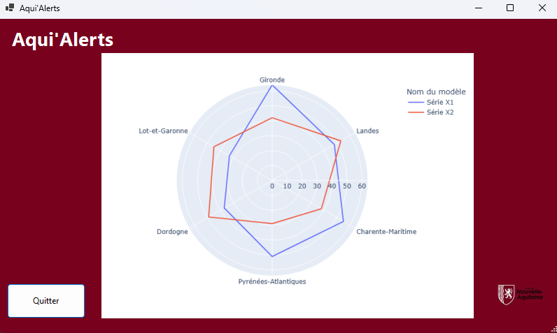
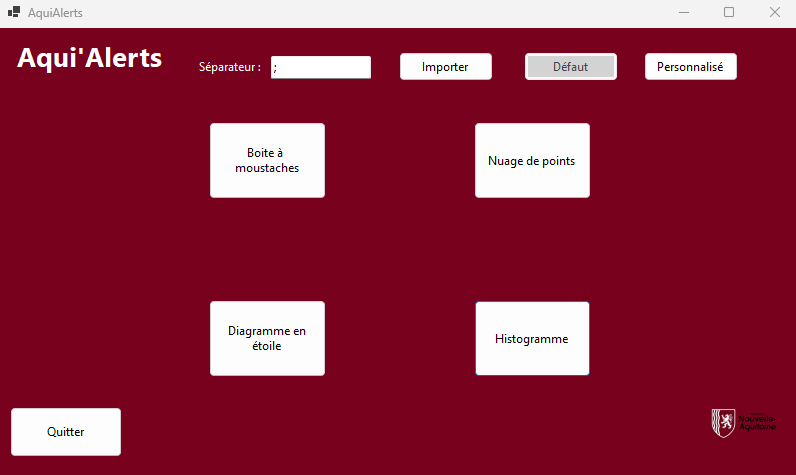
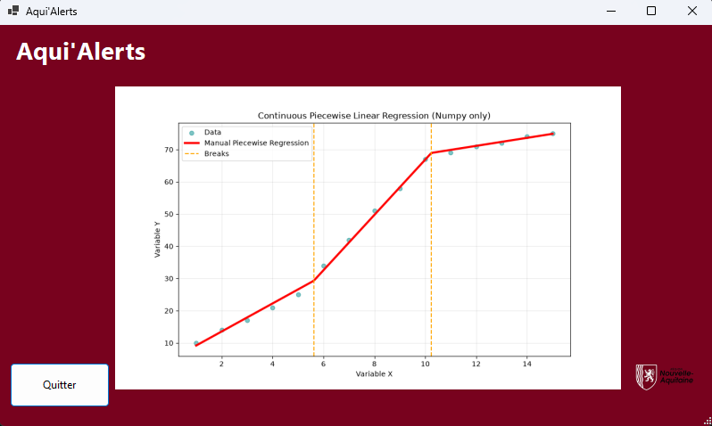
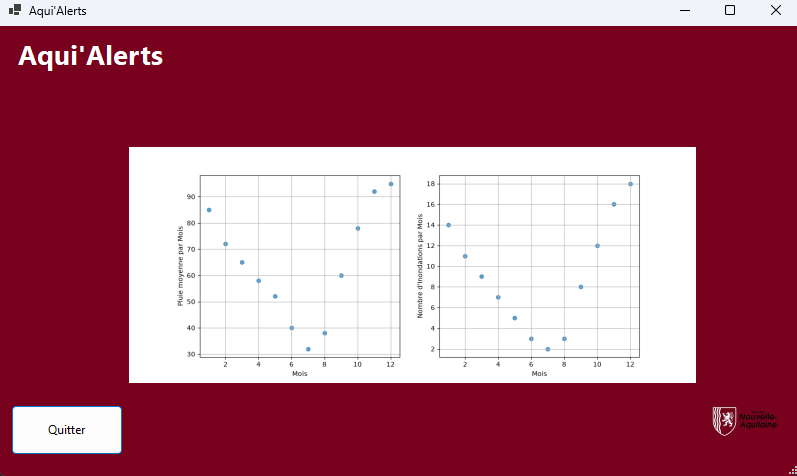
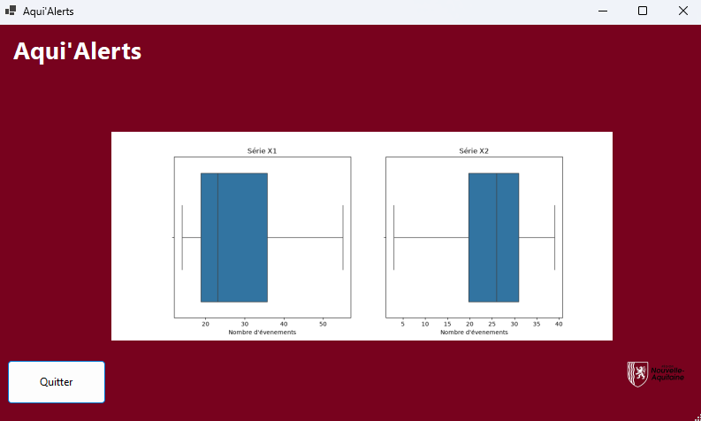

# Aqui'Alerts — Climate Risk Analytics & Dashboard

[Version Française](README.fr.md)


*C# WinForms dashboard displaying a Plotly polar radar chart comparing multi-department climate event distributions (`Gironde`, `Landes`, `Charente-Maritime`, etc.).*

Aqui'Alerts is a comprehensive climate risk and environmental analytics platform combining a **C# .NET Windows Forms desktop application** for querying and visualization control, with a **Python data analytics backend** using Matplotlib, Seaborn, Plotly, and Pandas to generate dynamic statistical graphs and choropleth maps.

---

## Interface & Usage


*C# desktop application default preset dashboard, CSV import controls with custom delimiter, and mode switcher (`Défaut` / `Personnalisé`).*

The application provides an intuitive desktop interface for operators to load regional CSV datasets, execute custom SQL queries against the underlying database, and instantly render multi-variable statistical graphs.

---

## Analytics & Algorithms


*Custom continuous piecewise linear regression algorithm implemented in pure NumPy with quantile-based breakpoints.*

### Advanced Statistical Modules
- **Piecewise Linear Regression**: Models complex non-linear ecological and climate trends by fitting segmented linear regressions across data quantiles.
- **Comparative Statistical Gallery**:

| Scatter Plot Correlation | Statistical Box Plot |
| :---: | :---: |
|  |  |
| *Dual-series comparative statistical visualizations (`Série X1` vs `Série X2`) generated via the C#-to-Python pipeline.* | *Distribution analysis across multiple environmental risk indicators.* |

---

## Architecture

```text
climate-risk-analytics/
├── Aqui'Alerts C#/          # C# .NET Windows Forms desktop application
├── Aqui'Alerts SQL/         # Database models (MCD, MLR scripts, SQL dumps)
└── pythonScripts/           # Python data processing and chart generation scripts
    ├── choosenGraph.py      # Main entry point (dispatcher)
    ├── boxplot.py           # Statistical box plots
    ├── radarChart.py        # Multi-axis radar charts
    ├── scatterPlot.py       # Correlation scatter plots
    ├── linearRegression.py  # Trend analysis & linear regression
    ├── histogram.py         # Frequency distribution histograms
    ├── parallelCoordinates.py# Multivariate parallel coordinates
    ├── geographicPlot.py    # Choropleth risk maps
    └── requirements.txt     # Python dependencies
```

## Requirements (Windows)

To run the complete application stack on Windows:
- **Windows 10 / 11**
- **.NET 8.0 SDK** (for the C# Windows Forms application)
- **Python 3.10+** (with pip)
- **SQL Database** (MSSQL / MySQL / compatible SQL backend)

## How to Start on Windows

### 1. Database Setup
Import the database schema and initial data from the `Aqui'Alerts SQL/` directory into your SQL server instance.

### 2. Python Environment Setup
Open Command Prompt or PowerShell in the `pythonScripts/` directory and install dependencies:
```cmd
cd pythonScripts
pip install -r requirements.txt
```

### 3. Running the C# Desktop Application
1. Open the C# solution in Visual Studio (`Aqui'Alerts C#/Aqui'Alerts/Aqui'Alerts.sln`).
2. Configure your database connection string in project settings.
3. Press `F5` to build and run the application. The C# UI will invoke the Python scripts automatically when generating analytics charts.

---
**Documentation & Details:** See individual subdirectories for SQL schemas and specific Python module functions.
